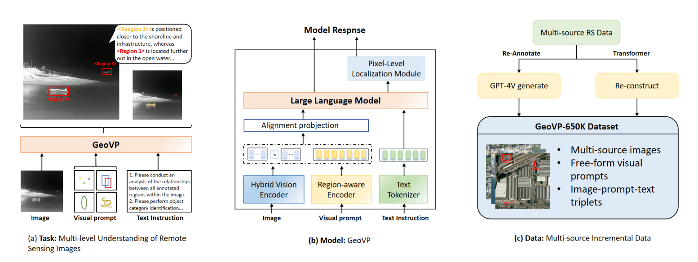
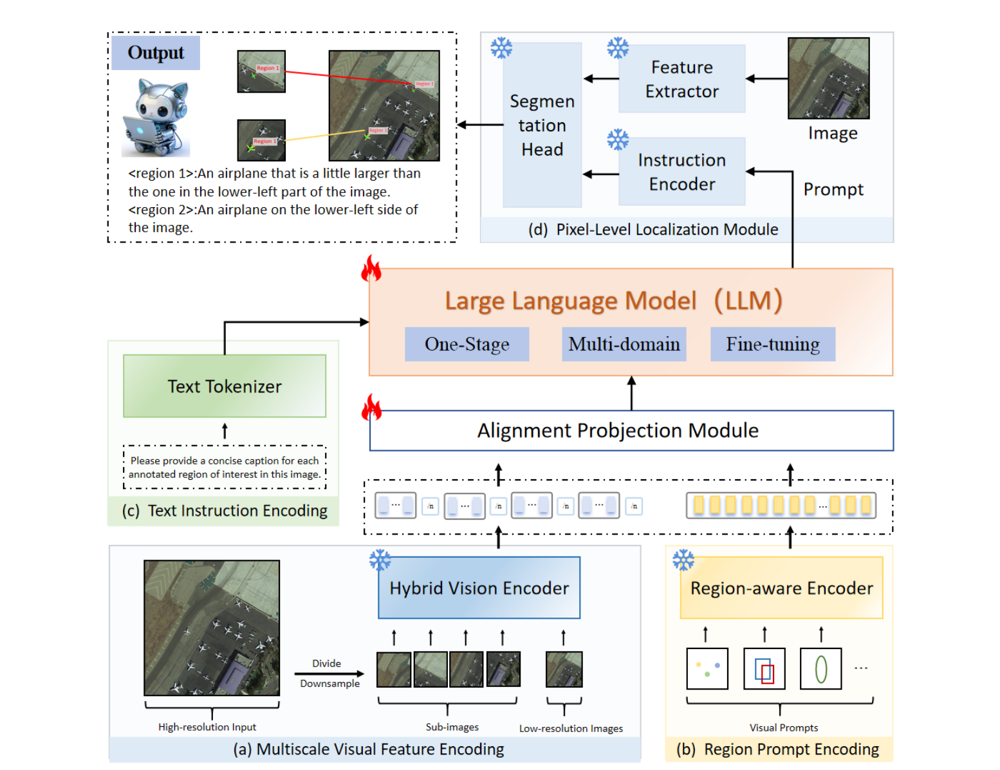

# GeoVP

<div align="center">

### A Unified Visual Prompting Framework for Multi-Source Remote Sensing Image Understanding

**Le Yu · Yuanwen Wang · Xiaotong Qi**

**Point · Box · Free-form** &nbsp; | &nbsp; **Optical · SAR · Infrared**

[Overview](#overview) · [Architecture](#architecture) · [GeoVP-650K](#geovp-650k) · [Results](#results) · [Release Status](#release-status) · [Citation](#citation)

</div>

GeoVP combines visual prompts with language instructions to understand user-selected regions in remote sensing imagery. A single framework connects global scene context, local region representations, and language reasoning across optical, synthetic aperture radar (SAR), and infrared images.

**Release scope:** This public repository currently contains the GeoVP research overview and manuscript figures. Source-code publication is pending license-notice confirmation. Model weights and GeoVP-650K annotations are not included. The results below are reported from the manuscript.



*Fig. 1. Overview of GeoVP for multi-source remote sensing visual prompting.*

## Overview

Text alone can be ambiguous when referring to small objects or irregular regions in complex remote sensing scenes. GeoVP provides an explicit spatial interface: select a point, draw a box, or specify a free-form region, then ask the model about the selected content.

- **Flexible visual prompting.** Points, bounding boxes, scribbles, polygons, and masks share a unified region representation.
- **Multi-source understanding.** Optical, SAR, and infrared imagery are organized within the same image–region–language framework.
- **Multiple semantic granularities.** Tasks include scene classification, referring object category recognition, region captioning, detailed description, and cross-region relationship analysis.
- **Cross-domain training.** A one-stage strategy aligns visual prompts with language reasoning across natural-image and remote sensing domains.

Example instructions for the paper's visual prompting formulation:

| Task | Instruction |
| --- | --- |
| Targeted recognition | What is the category of the object at the marked point? |
| Region captioning | Provide a concise caption for region 1. |
| Detailed description | Describe the objects and spatial layout inside the selected region. |
| Relationship analysis | How is region 1 spatially related to region 2? |
| Scene understanding | Summarize the overall scene and its main features. |

## Architecture



*Fig. 2. Overall architecture of GeoVP.*

GeoVP takes an image, visual prompts, and a textual instruction as inputs:

1. **Hybrid Vision Encoder.** CLIP-ConvNeXt-L and DINOv2 ViT-L/14 extract complementary semantic and structural features. A 448 × 448 image is represented by one global view and four local views, each at 224 × 224 resolution.
2. **Region-aware Encoder.** Heterogeneous prompts are converted into foreground masks. The encoder samples 512 foreground points and applies two farthest-point-sampling and nearest-neighbor aggregation blocks to produce compact region representations.
3. **Alignment Projection Module.** Lightweight projectors map image features and region features into the language model's embedding space. Region tokens combine prompt-conditioned structure with local visual semantics.
4. **Language reasoning.** LLaMA 2-13B jointly processes image-level tokens, region-level tokens, and text instructions to generate a response.
5. **Pixel-Level Localization Module.** An auxiliary SAM-based branch supplies qualitative mask visualizations for prompted regions. These masks are localization cues; the paper does not report quantitative segmentation performance.

During one-stage training, the visual backbones and SAM components remain frozen. The Region-aware Encoder, alignment projectors, and language-side LoRA parameters are optimized with an autoregressive language modeling objective.

## GeoVP-650K

GeoVP-650K contains **654.45K image–prompt–text triplets**, covering multiple sensing modalities and task granularities. The count refers to reconstructed training triplets; multiple triplets may share the same source image.

| Data branch | Supervision |
| --- | --- |
| Optical | Point-based object recognition, box-based region captioning, image captioning, and scene classification |
| SAR | Box-based object recognition, regional descriptions, and relationship analysis |
| Infrared | Box-based object recognition, regional descriptions, and relationship analysis |
| GPT-4V-assisted annotations | Fine-grained captions and relations with region-reference checks, consistency filtering, and manual inspection of a stratified subset |

Point, box, and free-form annotations are standardized into a shared prompting format. Free-form prompts derived from point or box annotations are not counted as additional triplets.

## Results

The following headline results are reported in the GeoVP manuscript:

| Benchmark | Evaluation setting | Metric | GeoVP |
| --- | --- | --- | ---: |
| AID | Zero-shot scene classification | Average accuracy | **79.05%** |
| UCMerced | Cross-task scene classification | Average accuracy | **87.55%** |
| DIOR-RSVG | Held-out, box-prompt-conditioned region understanding | Average semantic IoU (S-IoU) | **98.25%** |

AID is excluded from GeoVP-650K. UCMerced is evaluated across tasks because UCM-Captions shares its image source with the classification benchmark. DIOR-RSVG uses its held-out split. S-IoU measures semantic category agreement in this evaluation and should not be interpreted as mask segmentation IoU.

### Training configuration in the paper

| Setting | Value |
| --- | --- |
| Language backbone | LLaMA 2-13B |
| Visual backbones | CLIP-ConvNeXt-L + DINOv2 ViT-L/14 |
| Input resolution | 448 × 448 |
| Optimizer | AdamW |
| Learning rate / weight decay | 2 × 10⁻⁵ / 0.01 |
| Schedule | Cosine decay; 0.03 warm-up ratio |
| LoRA | Rank 16; scaling factor 32; upper 30 Transformer layers |
| Training length | One epoch |
| Effective batch size | 64 |
| Hardware | 8 NVIDIA A100 GPUs |

## Release Status

This release includes the paper overview, architecture figures, dataset summary, and reported experimental results. The source snapshot is being prepared for publication. The paper-specific Region-aware Encoder, complete visual prompt input pipeline, model weights, and training annotations are not available in this release.

## Citation

If you use GeoVP in your research, please cite the manuscript:

```bibtex
@misc{yu_geovp,
  title  = {GeoVP: A Unified Visual Prompting Framework for Multi-Source Remote Sensing Image Understanding},
  author = {Yu, Le and Wang, Yuanwen and Qi, Xiaotong},
  note   = {Manuscript}
}
```

## Contact

For research questions, please contact **Yuanwen Wang** at [wyww0626@gmail.com](mailto:wyww0626@gmail.com).
